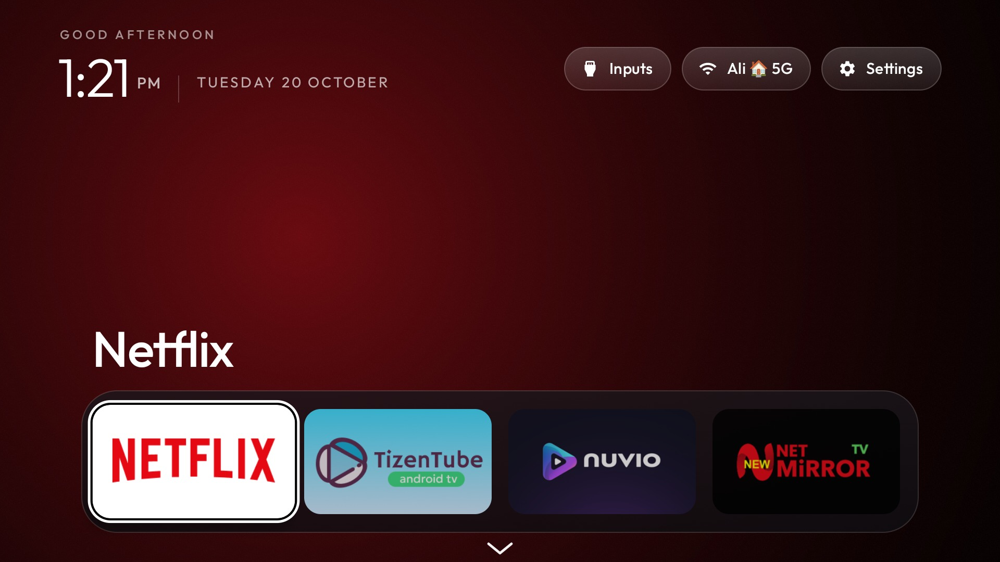
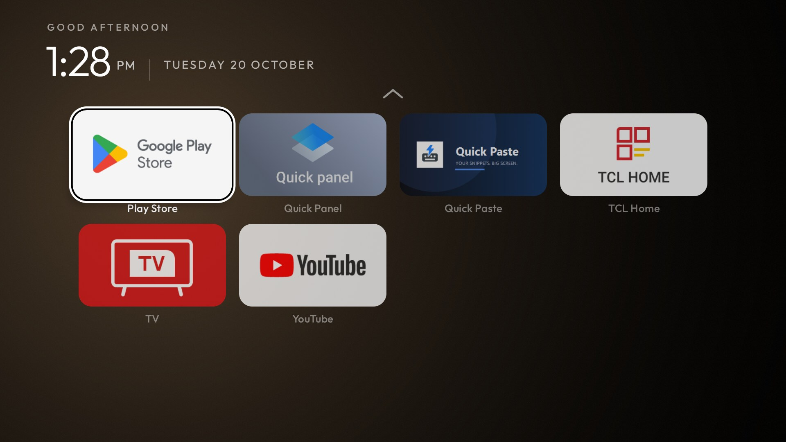
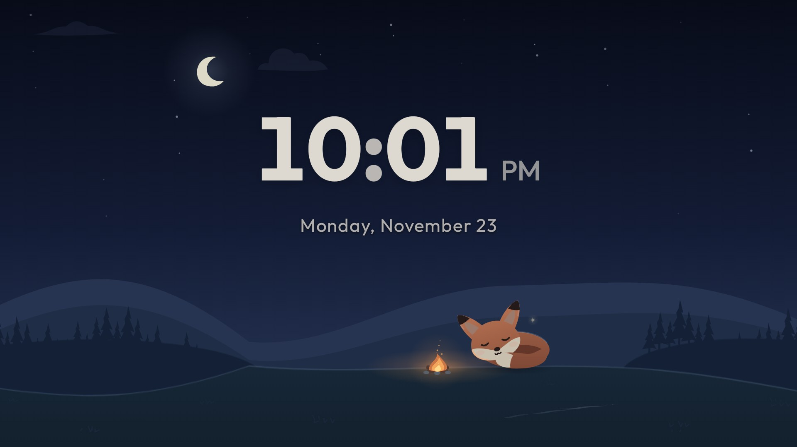

<div align="center">



# Clean Home

**A quiet Android TV home screen. No rows of recommendations, no billboard, no feed — a clock, your apps, and a fox that goes to sleep at ten.**

[](#at-a-glance)
[](#at-a-glance)
[](#at-a-glance)
[](#at-a-glance)
[](#why-this-exists)

</div>

Clean Home is a native launcher for Android TV, written from scratch in Java and installed as the Home app on a **TCL 43" P7K (G10, Android 12)**. It replaces Google TV's home screen — which on this set is mostly advertising — with a black canvas that puts four apps on screen, lights the room with the colour of whichever one has the focus, and gets out of the way.

It is also the front half of a larger job: forty packages were disabled on the same television, none of them uninstalled, and this repository carries the backup lists and the one-command restore that puts Google TV back.

Everything here has been measured on the actual panel — frame timings with `dumpsys gfxinfo`, geometry in pixels from screenshots, the bedtime animation frame by frame. Where something is still open, it says so.

---

## At a glance

| | |
| --- | --- |
| Package | `com.cleanhome.tv` |
| Built for | TCL G10 / "Smart TV Pro", Android 12 (API 31), 3840×2160 panel running at 1920×1080 @ 320 dpi |
| Language | Java 17, no Kotlin, no Compose |
| minSdk / targetSdk | 31 / 34 |
| Dependencies | `androidx.recyclerview:recyclerview:1.3.2` — that is the whole list |
| Source | 32 classes, ~7,900 lines, plus four JVM state-machine tests |
| Debug APK | 5.1 MB |
| Screens | Home, other apps, long-press menu, edit app, icon picker, photo picker, launcher settings, screensaver preview |
| Screensaver | A `DreamService` with four backgrounds, one of them NASA satellite photography downloaded daily |

---

## Contents

- [Why this exists](#why-this-exists)
- [The home screen](#the-home-screen)
- [Moving around](#moving-around)
- [The other apps screen](#the-other-apps-screen)
- [Long press, rename, re-icon](#long-press-rename-re-icon)
- [The launcher's own settings](#the-launchers-own-settings)
- [Screensavers](#screensavers)
- [Design details](#design-details)
- [State machines](#state-machines)
- [Performance](#performance)
- [Build and install](#build-and-install)
- [Turning Google TV off](#turning-google-tv-off)
- [Day-to-day tasks](#day-to-day-tasks)
- [Troubleshooting](#troubleshooting)
- [Repository layout](#repository-layout)
- [Documentation](#documentation)
- [Known limits](#known-limits)
- [Credits](#credits)

---

## Why this exists

The stock Google TV launcher answers a question nobody asked at eight in the evening: *what should I watch that someone paid to put here?* On a 43" set in a living room it costs a row of adverts, a sponsored carousel and a cold start before you reach the app you opened the television for.

Clean Home is the other trade. One screen, four apps, one clock. Press Home and you are on Netflix in the time it takes the panel to wake up. The whole design brief fits in a sentence: **the television should look like a television, not a shop.**

The rest of the job was subtraction. Forty packages — telemetry, TCL's content channels, onboarding wizards, a file manager nobody opened — were disabled for the owner with `pm disable-user`, never uninstalled, with the complete before-state captured in [`backup/`](backup/) so any of it can come back. [`restore.ps1`](restore.ps1) puts all of it back, Google TV home included, in one command.

---

## The home screen

Black canvas. Top left: a greeting, the time in a thin face, the date. Top right: three frosted pills — Inputs, Wi-Fi, Settings. Bottom: the dock, four cards in a translucent container. Between them, a colour wash that belongs to whichever app has the focus.

**The clock block.** `Good morning` / `Good afternoon` / `Good evening`, the time, and the date, set in [Outfit](#credits) with wide letter spacing. The greeting and clock are deliberately unequal: the time is the headline, everything else is a caption.

**The wash.** A full-screen radial gradient sampled from the focused app's artwork — Netflix gives deep red fading to black on the right, TizenTube gives teal. A dark app would give a black room, so `AppLoader.lift()` raises the sampled colour until it can actually light the panel and nudges washed-out samples away from grey. The centre of the glow drifts as the focus moves along the dock, and the colour cross-fades over 420 ms.

**The dock.** Four cards, 180 × 101 dp, 16 dp corner radius, 16 dp apart, inside a container with 18 dp padding and a 34 dp radius — the card radius plus the padding, so the inner and outer curves are concentric instead of merely close. The container is a translucent dark shape with a faint white line.

**The focus ring.** One crisp 2.5 dp white stroke that runs parallel to the card, with an even band of dark between the card and the ring. That seam is the point: a plain white ring is invisible on the white Netflix card. The ring is drawn at the card's *live* scale, so a card that is growing never outgrows its ring.

**The movement.** A focused card goes to 1.08×, full brightness and lifts 8 dp; the others drop to 0.78. Everything that moves uses one length and one curve — `Motion.DURATION`, 200 ms, decelerating. The card that grows, the ring that travels, the menu row that lights up and the title that changes all use it, so they cannot drift apart.

**The sound.** Android plays no click when a view takes focus here, because the launcher runs its own focus model and the framework never hears about it. `FocusSound` plays the system's own key click instead, follows the system sound-effects setting, and swallows repeats inside 45 ms so a fast sweep along the dock is not a machine gun.

**The pictures.** No ripple, no card shadow, no scale bounce. The motion, the lift and the click are the tactile cues; everything else is quiet.

---

## Moving around

Four zones, all reachable with the D-pad:

| Zone | How you get there | What it holds |
| --- | --- | --- |
| **Top** | Up from the dock | Inputs, Wi-Fi and Settings pills |
| **Dock** | Home, or Back from the grid | The apps you actually use |
| **Grid** | Down from the dock | Everything else that is installed |
| **Menu** | OK on Inputs, or long press on a card | The input list, or the card's own menu |

The rules are small but they are what makes the remote feel right:

- **Home always lands on the first dock app.** Every launch and every press of Home resets the focus to Netflix, so you never have to hunt for where you left the ring.
- **Ends of rows do not fall through.** Pressing Left on the first card opens the launcher's settings instead of doing nothing; pressing Right on the last card stays put.
- **Down from the dock opens the grid; Up from its first row closes it.**
- **A hidden button is skipped, not disabled.** If the owner hides Inputs in settings, the focus steps over it, and when all three are hidden, Up from the dock does nothing at all rather than opening a menu that is not on screen.
- **A jump is not a slide.** Moving between parts of the screen — a card to a menu row — the ring goes straight to the new place and fades back in. Only a move within the same part slides. A ring that flies across the panel reads as a bug.

The three pills open the real thing underneath: Inputs lists HDMI/AV/tuner from `TvInputManager` and switches with `TvContract`; Wi-Fi opens the Android Wi-Fi screen and shows the current network name on the button itself; Settings opens the TV's settings.

---

## The other apps screen



Down from the dock and the dock itself slides out of its own place and fades, the three pills fade after it, and the grid takes the room. Everything else about the screen is the same language: same card size, same 16 dp radius, same ring, same wash.

- **The columns line up with the dock.** The grid is measured at run time and nudged so its first column sits at the same anchor as the first dock card.
- **Two rows fit whole.** Six apps in two rows of four, with the labels clear of the ring: the gap between a card and its label is 16 dp, and the focused label steps 5 dp further down, out of the ring's way.
- **A short last row does not trap the focus.** Down from the third column has nothing directly below it, so the focus moves to the last card of that row instead of sitting still and reading as a dead key.
- **The up chevron is part of the first row.** It is drawn as a decoration above the grid rather than pinned to the screen, so it scrolls away with the row it belongs to and is never floating over the cards.
- **The glow follows two axes.** The wash moves with the column and with the row, so the light tracks the ring instead of sitting in the middle of the panel.
- **The grid only scrolls when it has to.** If the rows fit, it stays at the top.

---

## Long press, rename, re-icon

Hold OK on a card and a glass menu opens on the same curve as everything else:

| Row | What it does |
| --- | --- |
| **Move in dock** | Reorder the card within the dock |
| **Add to dock** | Put a grid app into the dock |
| **App Info** | Android's application details screen |
| **Uninstall** | The system uninstall dialog — system apps refuse by themselves |
| **Edit** | Rename it, change its picture, or give it another app's icon |

**Edit** is where the launcher stops being a grid and starts being yours. The name field is dark, the keyboard stays down until you press OK on it, and the cursor sits at the end of the name rather than in front of it. The preview shows the art the home screen will actually use — your saved picture, else the app's Leanback banner, else its icon — because previewing the round icon while the dock shows the wide banner is a small lie the eye catches immediately.

Three ways to change a picture:

- **Icons from this app** — its banner, its icon, the art Home already uses.
- **Use another app's icon** — a horizontal row of the other apps' art.
- **Add photo** — a built-in picture picker, four columns, newest first, reading `MediaStore` directly. The system picker cannot be used on this set: the only activity advertising `GET_CONTENT` for images belongs to a package that is disabled, so the chooser answers "You don't have an app that can do this."

**Reset to original** clears the name, the icon and the saved picture at once, no Save needed. Overrides live in the launcher's own `app-styles` preferences and never touch the real app: the television says `YouTube` on this screen because that is what the owner typed, and the app itself is still TizenTube.

---

## The launcher's own settings

Press **Left on the first card of the dock**. A two-column screen opens: section names down the left, the section itself on the right, the ring moving between them on the same curve as everywhere else.

| Section | What you can do |
| --- | --- |
| **Dock** | The dock as small cards with names, plus an "Add" card at the end. OK replaces a slot; long press opens move left, move right, change the app, take it out. |
| **Buttons** | Inputs, Wi-Fi and Settings, each a row with a `SHOWN` / `HIDDEN` pill. A hidden button disappears from the home screen *and* from the focus order. |
| **Clock** | Time format (follow the TV, or force 12/24-hour), "Back opens screensaver", the screensaver background, and a preview. |
| **More** | Put the dock back to how it was, bring the three buttons back, close. |

The dock is no longer a list in the source. It is read from and written to preferences — `Dock.DEFAULT` is only the starting point — so the dock can be rearranged from the sofa without a build.

---

## Screensavers

The launcher ships its own `DreamService`, `com.cleanhome.tv/.ClockDream`, with four backgrounds. Choose one in **Settings → Clock → Screensaver background**; the change applies the next time the set idles.

| Background | What it is |
| --- | --- |
| **Ambient · Minimal Fox** | A sky that warms and cools with the hour, a small fox above the clock, and a colon that breathes. |
| **Fox Meadow · Illustrated landscape** | A 24-hour illustrated meadow. The fox wakes, follows a flock of birds with its head at nine, sits by a fire at night and is asleep by ten. |
| **Daily Earth · NASA satellite photography** | Today's true-colour MODIS Terra mosaic of one of seven regions — Makran Coast, the Red Sea, Western Australia, the Mediterranean, the Himalayas, Baja California, the Namib Coast — downloaded once a day, cached, with the place and credit on screen. |
| **Dusk · Ambient gradient** | A static dusk gradient and the large clock, nothing else. |



**Fox Meadow** is the one with a schedule. `FoxHourlySchedule` owns 24 palettes and interpolates them minute by minute, so the light at 06:40 is between dawn and morning. The fox is a separate view with its own poses; at 21:59 it settles, tucks its tail and sleeps. Dawn adds a low haze and dew beads on the grass; after dark the larger stars carry a soft halo. The preview shows a fading control legend on entry and after each press: **Left and Right step through the 24 hours**, **OK greets the fox**, and only **Back** leaves. The automatic screensaver follows the television's clock.

A note for anyone reading the source: the handoff document records that this panel presents the Fox Meadow scene at **50 fps**, and that a solid-colour control and a build with the frame gate disabled all measured the same 50. The cause is still open, it is described in [`summary.md`](summary.md), and no 60 fps claim is made for it.

To make it the set's screensaver:

```powershell
$tv = "192.168.1.21:5555"
adb -s $tv shell settings put secure screensaver_components com.cleanhome.tv/.ClockDream
```

To see it without waiting for the set to idle, open **Settings → Clock → Preview screensaver**. The preview activity is intentionally not exported, so `am start` cannot reach it — use the settings row, which also previews every hour of the meadow.

---

## Design details

The parts that are not obvious from a screenshot, with the numbers they are built on:

| | |
| --- | --- |
| Card | 180 × 101 dp, 16 dp radius, centre-cropped art |
| Dock container | 34 dp radius = 16 dp card + 18 dp padding |
| Focus ring | 2.5 dp stroke, dark seam inside, drawn at the card's live scale |
| Focused card | 1.08× scale, full brightness, 8 dp lift; others at 0.78 |
| Motion | 200 ms, decelerating — one constant, `Motion.java` |
| Wash cross-fade | 420 ms, 12-stop gradient |
| Grain | 1.5% tile over the wash, to survive an 8-bit panel |
| Typeface | Outfit, 500 weight for titles, tight negative tracking |

Three decisions are worth spelling out because they were not free:

- **No dither.** Dithering a full-screen paint on this Realtek GPU costs about 30 ms per frame and pushes the frame onto the slow path. Removing it took the dock from 57 ms to 26 ms, and the grain tile hides what dither would have covered.
- **The gradient is baked once.** The wash is drawn into a white mask at a fifth of screen size, stretched to twice the screen and tinted with a colour filter. The fade changes only the tint; nothing rebuilds a shader per frame.
- **The ring lives outside the card.** Google TV's own launcher puts the focus ring inside the card as a foreground, which makes it free to scale but forces the art smaller. This launcher keeps the art at full size and draws the ring on the root instead, which costs a per-frame position update and pays for itself in the picture.

---

## State machines

The remote is a state machine, not a mouse. The launcher's focus zones, the dock reorder mode, the card menu, the picker screens and the screensaver all have a small set of states and a small set of legal moves between them. They are written down in [`docs/state-machines.md`](docs/state-machines.md), with the invariants that keep a dead key, a hidden focus target or a stale menu from happening.

The parts that can be tested without a screen are plain Java: `DockReorder`, `EditSession`, `IconPickerState` and `Epoch`. `HomeZone` is a plain enum, and the home renderer draws every zone from that one value. The rest of the launcher renders each screen from its state, so a new state is a change in one place rather than a visibility toggle at every call site.

```powershell
cd launcher
.\gradlew.bat :app:testDebugUnitTest --offline
```

---

## Performance

Measured on the installed build with `dumpsys gfxinfo` over a scripted D-pad sweep, after a `gfxinfo reset`:

| Screen | Frames | p50 | p90 | Janky |
| --- | ---: | ---: | ---: | ---: |
| Dock, 20 D-pad moves | 534 | 16 ms | 24 ms | 2.81% |
| Grid, 16 moves + scroll | 400 | 13 ms | 19 ms | 2.75% |
| Settings | — | 7 ms | 13 ms | 3.36% |

The pass that produced those numbers started at 40% janky frames on the dock. It is written up step by step in [`summary.md`](summary.md) — what was measured, what was removed, and which measurement changed the diagnosis.

---

## Build and install

**You need:** JDK 17 on `PATH`, the Android SDK (`platforms;android-34`, `build-tools`), and `adb` from `platform-tools`. On Windows, PowerShell 5.1 is fine — the scripts avoid `&&`.

The project builds with AGP 8.7.3 and the Gradle wrapper 8.9; the wrapper is committed, so nothing else has to be installed. `local.properties` is written by the installer if it is missing.

```powershell
cd launcher
powershell -ExecutionPolicy Bypass -File .\build-and-install.ps1
```

The script finds the television on the local network by its mDNS service name, then:

1. builds `:app:assembleDebug`,
2. pushes the APK to `/data/local/tmp/cleanhome.apk` and runs `pm install -r`,
3. re-reads the installed APK and compares its **SHA-256** with the one it built,
4. sets `cmd package set-home-activity --user 0 com.cleanhome.tv/.MainActivity`,
5. resolves `android.intent.action.MAIN` + `HOME` and refuses to continue if Android picked anything else,
6. presses Home.

Two things go wrong often enough to be worth writing down. The set's address is DHCP, so if discovery fails, pass it: `-Serial 192.168.1.21:5555`. And after a reboot the television asks for USB debugging authorisation again — nothing runs from the PC until that dialog is accepted with the remote.

```powershell
$tv = "192.168.1.21:5555"
adb connect $tv
adb -s $tv push app\build\outputs\apk\debug\app-debug.apk /data/local/tmp/cleanhome.apk
adb -s $tv shell pm install -r /data/local/tmp/cleanhome.apk
adb -s $tv shell cmd package set-home-activity --user 0 com.cleanhome.tv/.MainActivity
```

Use `push` + `pm install -r` rather than `adb install` — the latter hangs on this set.

---

## Turning Google TV off

This is the other half of the project, and it is deliberately reversible. **Forty unique packages were disabled with `pm disable-user --user 0`; none were uninstalled.** Two of them — Miracast and MagiConnect — were later turned back on so the PC can cast to the set.

| Group | Examples |
| --- | --- |
| Telemetry and feedback | `com.tcl.logkit`, `tv.samba.ssm.ui`, `com.google.android.feedback` |
| TCL content, ads, onboarding | `com.tcl.waterfall.overseas`, `com.tcl.channelplus`, `com.tcl.messagebox`, `com.tcl.useragreement` |
| Preloads and clutter | `com.tcl.gamebar`, `com.tcl.repairguide`, Google Play Games, TCL Guard |
| Streaming apps the owner dropped | Prime Video, YouTube Music, Instagram, TCL Browser, LocalSend |
| Voice and casting the owner turned off | `com.tcl.smartalexa`, both AirPlay packages |
| Accessibility and account | TalkBack, HearAid, `com.tcl.usercenter` |
| The old home screen | `com.google.android.apps.tv.launcherx`, `com.google.android.tungsten.setupwraith` |

<details>
<summary><b>Packages that must never be disabled</b></summary>

`com.tcl.tv` (Live TV and HDMI), `com.tcl.tvinput`, `com.tcl.dashboard`, `com.tcl.suspension` (quick panel), `com.tcl.autopair`, `com.tcl.systemserver`, `com.tcl.providers.config`, `com.tcl.factory.view`, `com.tcl.initsetup`, both keyboards, Play Store `com.android.vending`, Google Play services and `gsf`, `com.android.tv.settings`, Bluetooth, `com.realtek.power`, `com.realtek.dongledetect`, SystemUI, `com.google.android.tv.remote.service`, Assistant `com.google.android.katniss`, Chromecast `com.google.android.apps.mediashell`, Netflix, YouTube and the three dock apps.

Disabling any of these costs you Live TV, the remote, the store, or the keyboard. The full list and the reasoning for each is in [`summary.md`](summary.md).
</details>

<details>
<summary><b>Why the Home swap needs an order</b></summary>

`set-home-activity` is ignored while a higher-priority HOME activity is still enabled. Google TV's launcher sits at priority 2 and setup recovery at priority 1, so the order is: install, set home to Clean Home, disable `launcherx`, disable `setupwraith`, set home again, then verify with `resolve-activity`. Skip the setup recovery step and Home can land in the setup wizard. [`restore.ps1`](restore.ps1) reverses all of it.
</details>

**To put everything back:**

```powershell
powershell -ExecutionPolicy Bypass -File .\restore.ps1
```

That re-enables every package in [`backup/disabled-by-us.txt`](backup/disabled-by-us.txt), turns the stock launcher and setup recovery back on, points Home at `com.google.android.apps.tv.launcherx/.home.HomeActivity`, restores the original screensaver and presses Home. Factory-disabled `com.google.android.videos` was never touched and stays as it was.

The before-state of the whole device is in [`backup/`](backup/): every package, its components, its roles, and the three settings namespaces.

---

## Day-to-day tasks

Set the television's address once and reuse it:

```powershell
$tv = "192.168.1.21:5555"
adb connect $tv
```

**Change the dock.** Settings → Dock, or edit `Dock.DEFAULT` in [`Dock.java`](launcher/app/src/main/java/com/cleanhome/tv/Dock.java) and rebuild. An app that is not installed is skipped; everything else stays in the grid, alphabetically.

**Change the wallpaper.** The background stays black until a picture is present. After the launcher has opened once:

```powershell
adb -s $tv push wallpaper.jpg /sdcard/Android/data/com.cleanhome.tv/files/wallpaper.jpg
```

`wallpaper.png` works the same way. Restart the launcher; delete the file to go back to black. The file is only read from the app's own folder.

**Rename an app or change its icon.** Long press → Edit, as above. This affects the home screen only.

**Turn one package back on.**

```powershell
adb -s $tv shell pm enable --user 0 com.example.app
```

USB media playback needs `com.tcl.ui_mediaCenter`; a soundbar firmware update needs `com.tcl.UpdatePeripheral`. Firmware updates and TCL analytics are the same package, `com.tcl.ttvs`.

**Fix the Wi-Fi button.** The button shows the network name only if the launcher may read it — Android 12 gates the SSID behind location access. It asks once; to grant it later:

```powershell
adb -s $tv shell pm grant com.cleanhome.tv android.permission.ACCESS_FINE_LOCATION
```

**Wireless display from the PC.** The TV is a Miracast sink and appears in Windows as **Ali TCL**, but only while TCL's own sink is running: open **MagiConnect → Wireless Display**, press OK through the two tutorial pages, then `Win` + `K` on the PC. Network adb drops for a few seconds while Wi-Fi Direct starts. The sink screen is `FLAG_SECURE`, so screenshots of it are blank by design.

**Find the set after the router moves it.** The address is DHCP and changes now and then.

```powershell
adb mdns services   # adb-... _adb._tcp 192.168.1.x:5555
```

---

## Troubleshooting

| Symptom | Cause | Fix |
| --- | --- | --- |
| `adb connect` times out | The router issued a new address | `adb mdns services`, then connect to that address |
| `unauthorized` after a reboot | The debugging prompt was never accepted | Accept it on the TV with the remote |
| `adb install` hangs | Known on this set | `push` the APK and `pm install -r` |
| Grid is empty | Package visibility on Android 11+ | The `<queries>` block in the manifest must stay |
| Screenshot is 0 bytes | PowerShell redirection corrupts PNG | `cmd /c "adb ... exec-out screencap -p > shot.png"` |
| Wi-Fi pill says "Wi-Fi" | Location permission not granted | `pm grant ... ACCESS_FINE_LOCATION`, or accept the prompt |
| App does not appear after install | The list is cached | It reloads on `PACKAGE_ADDED` within 600 ms; restart the launcher if a broadcast was missed |
| Ring sits away from a card | Geometry, usually the grid translation | See the `GridAlign` log tag; the full diagnosis is in `summary.md` |
| USB ports lose power | Network debugging left on | Turn debugging off in the TV settings when you are done |

One warning from the field: do not chain several `pm` commands in a single device shell. They stop after the first, silently.

---

## Repository layout

```
Tv Launcher/
├─ launcher/                     Android project (Gradle, Java 17)
│  ├─ app/src/main/java/com/cleanhome/tv/
│  │  ├─ MainActivity.java          Home: zones, wash, ring, title, input menu
│  │  ├─ HomeZone.java              The four home focus zones and their moves
│  │  ├─ DockReorder.java           Two-state dock reorder mode
│  │  ├─ Epoch.java                 Generation guard for async work
│  │  ├─ EditSession.java           Edit-screen load/selection state
│  │  ├─ IconPickerState.java       Apps / icons mode of the icon picker
│  │  ├─ Dock.java                  The dock, and the settings around it
│  │  ├─ CardArtView.java           The picture inside a card, dock and grid
│  │  ├─ CardFocus.java             The focused look: scale, brightness, lift
│  │  ├─ GlassHighlight.java        The ring itself
│  │  ├─ FocusRing.java             The same ring, reused on other screens
│  │  ├─ Motion.java                The one length and the one curve
│  │  ├─ FocusSound.java            The system click, on this launcher's focus
│  │  ├─ AppLoader.java             App list, art, sampled colour, lifting
│  │  ├─ LauncherSettingsActivity.java   Dock / Buttons / Clock / More
│  │  ├─ EditAppActivity.java       Rename, re-icon, reset
│  │  ├─ PhotoPickerActivity.java   The built-in picture picker
│  │  ├─ ClockDream.java            DreamService
│  │  ├─ ClockScreenActivity.java   Manual preview
│  │  ├─ FloatingClockView.java     Clock, date, and the four backgrounds
│  │  ├─ FoxMeadowView.java         The 24-hour meadow
│  │  ├─ FoxMascotView.java         The fox: poses, gestures, sleep
│  │  ├─ FoxHourlySchedule.java     24 palettes, interpolated by the minute
│  │  └─ EarthEdition.java          Daily NASA MODIS mosaic, cached
│  ├─ app/src/test/java/com/cleanhome/tv/
│  │  ├─ EpochTest.java             The generation guard
│  │  ├─ EditSessionTest.java       A late load cannot overwrite a choice
│  │  ├─ IconPickerStateTest.java   Apps and icons mode
│  │  └─ DockReorderTest.java       Begin, finish, cancel
│  ├─ livecable/                 Small helper activity for the cable input
│  └─ build-and-install.ps1      Build, verify, install, set as Home
├─ backup/                       Package, role and settings dumps before the debloat
├─ docs/                         Screenshots and the state-machine map
├─ restore.ps1                   Put Google TV back, one command
├─ summary.md                    The engineering log
└─ Qwen-Fox-Meadow-handoff.txt   Screensaver review notes and open questions
```

---

## Documentation

| File | What is in it |
| --- | --- |
| [`summary.md`](summary.md) | The long one. Every decision, every measurement, every trap that was already fallen into, and a **Do not** list that exists for a reason. |
| [`docs/state-machines.md`](docs/state-machines.md) | Every implicit state machine in the launcher: states, events, invariants, the code that owns each one, and the tests that guard it. |
| [`Qwen-Fox-Meadow-handoff.txt`](Qwen-Fox-Meadow-handoff.txt) | The screensaver reviewed from sofa distance: what was changed, what was measured, what is still open. |
| [`reverse engineer apk guide.md`](<reverse engineer apk guide.md>) | How Google TV's own launcher was decompiled on this machine, with the pitfalls. |
| [`backup/`](backup/) | The device before anything was disabled: packages, components, roles, settings. |

---

## Known limits

- **Fox Meadow presents at 50 fps on this panel**, not the 60 the display reports. A solid-colour control and a build with the frame gate removed measured the same 50, so the drawing code is not the limit. The investigation and the remaining hypotheses are in [`summary.md`](summary.md). The animation reads smooth; it is the presentation rate that is unexplained.
- **The Wi-Fi network picker was built and set aside.** Android 12 does not let a third-party app read or join saved networks; `addNetworkSuggestions` only suggests. The button opens the system Wi-Fi screen instead, where joining is one tap.
- **The "other apps" row in Edit scrolls sideways**, and the last icon is cut off until you move right. That is deliberate: a wrapping grid clipped the second row.
- **Debug build, unminified.** No release signing is configured; this is a personal appliance, not a Play Store release.
- **The abandoned Wi-Fi panel was removed from `MainActivity.java`.** The Wi-Fi pill opens the system screen; the old menu is documented in `summary.md` so it is not rebuilt by mistake.

---

## Credits

- **Outfit** by Rodrigo Fuenzalida, under the SIL Open Font License 1.1 — `launcher/app/src/main/assets/fonts/outfit.ttf`.
- **NASA GIBS / MODIS Terra** for the daily satellite edition. The mosaic is public domain; the credit line on screen reads *place · NASA / MODIS*.
- The debloat list began from [Gathin23/cleanyourtv](https://github.com/Gathin23/cleanyourtv) and was then measured against this specific set.

Not affiliated with Google, TCL or any of the apps in the dock. Built on one television, measured with `dumpsys`, and checked from the sofa.
