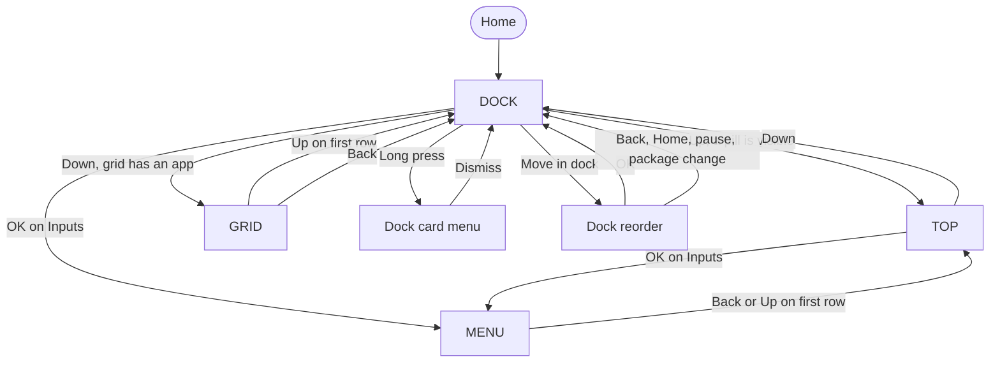

# State machines

This launcher is full of small state machines. Most of them began as a
boolean, an `int` sentinel or a nullable field, which is fine until two of
those fields disagree. This file is the map: every machine, the states it can
be in, the events that move it, the invariants that must hold, and the code
that owns it.

Use it in both directions:

- **Before changing a screen**, read the machine it belongs to. If the change
  adds a state, add it here and to the code that owns it.
- **When something looks wrong**, find the machine and check its invariant.
  A dead key, a ring in mid-air, a stale menu or a screen that ignores Back is
  almost always a broken transition, not a drawing bug.

The rule for new work is simple: one owner, a named state, explicit events, a
guard at the transition, and a render function that draws from the state.
Side effects happen after the state changes, never in the middle of deciding
what the next state is.

---

## The map



The four home zones are `TOP`, `DOCK`, `GRID` and `MENU`. The card menu and
dock reorder are overlays on top of the zone, not zones of their own.

---

## Inventory

| # | Machine | States | Owner | Guard / invariant |
| - | --- | --- | --- | --- |
| 1 | Home focus and navigation | `TOP`, `DOCK`, `GRID`, `MENU` plus one index per zone | `MainActivity`, `HomeZone` | A hidden pill never holds focus; a grid zone is only entered when the grid has a card; the menu is only open under a visible pill. |
| 2 | Dock reorder | idle, reordering(origin) | `DockReorder` | Origin is the slot the card started in; every exit either commits or reverts exactly once. |
| 3 | OK press gesture | idle, down, long-fired | `MainActivity` (`centerDown`, `centerWasLong`, `longPress`) | A long press fires once; the release after it must not also activate. |
| 4 | Back-to-screensaver gesture | idle, back-down | `MainActivity` (`clockBackDown`) | Only a clean press-and-release on DOCK/TOP starts the clock; moving focus or entering reorder cancels it. |
| 5 | Card options menu | closed, open(app) | `MainActivity` (`optionsDialog`, `optionsPackage`) | Only one menu; its app must still exist; Home and package removal close it. |
| 6 | Inputs overlay | closed, open(index) | `MainActivity` (`zone == MENU`, `menuIndex`, `menuPill`) | Rows can be rebuilt behind it; the index is clamped; Back returns to the pill. |
| 7 | App list load | idle, loading(token), ready | `MainActivity` (`appLoadEpoch`, `appsReady`) | Only the newest load may apply; an older one must not overwrite a newer list. |
| 8 | Package broadcast debounce | idle, pending, loading | `MainActivity` (`packageReceiver`, `packageReload`) | A burst of broadcasts produces one reload; a newer reload supersedes an older one. |
| 9 | Wi-Fi pill read | idle, reading(token), shown | `MainActivity` (`ssidEpoch`, `networkWatch`) | A slow SSID read never overwrites a newer one; a lost network never leaves the old name. |
| 10 | Hero title swap | hidden, showing(label), fading, swapping | `MainActivity` (`heroLabel`, `pendingHeroSwap`, `heroEpoch`) | Only one swap is pending; pausing invalidates it; a same-label render restores alpha only. |
| 11 | Focus ring | unplaced, shown, travelling, fading, hidden | `GlassHighlight` | Only one of travel/fade runs; a fade always ends at the latest target; hide resets alpha and position. |
| 12 | Card focus look | resting, focused | `CardFocus` | Stateless: the same scale, dim and lift everywhere; repeated calls are no-ops. |
| 13 | Settings section | Dock, Buttons, Clock, More | `LauncherSettingsActivity.Section` | Exactly one panel visible; the sidebar, title and subtitle come from the same enum value. |
| 14 | Settings app pick | none, add, replace(index) | `LauncherSettingsActivity.PickRequest` | A cancelled pick consumes its request; a result can only apply to the request that produced it. |
| 15 | Settings dialog | closed, open | `LauncherSettingsActivity` (`currentDialog`) | Back closes the dialog first and the screen second; only one dialog. |
| 16 | Edit screen | loading, ready; selection unknown/original/app/file; gallery copy(epoch) | `EditAppActivity`, `EditSession`, `Epoch` | A load that finishes late never overwrites a choice; Save with an unknown icon leaves the preference alone. |
| 17 | Icon picker | apps, icons(app, return position) | `IconPickerActivity`, `IconPickerState` | Back from icons returns to apps; Back from apps leaves the screen; OK means "open" in apps and "pick" in icons. |
| 18 | Photo picker | loading, empty, ready | `PhotoPickerActivity` | The screen says which one it is; the first tile only takes focus when there is a tile. |
| 19 | Clock preview | live, preview(hour) | `FloatingClockView` (`previewing`) | Stepping fixes the hour and the minute at the moment preview starts; the wall clock no longer moves the previewed time. |
| 20 | Earth edition fetch | idle, requested(day), loading(token), shown | `FloatingClockView`, `EarthEdition`, `Epoch` | One request per day per attached view; a detached view invalidates the result. |
| 21 | Meadow frame loop | stopped, running | `FoxMeadowView` (`enabled`, `visible`, `looping`) | The loop runs only when enabled, visible and attached; detaching cancels any bedtime transition. |
| 22 | Fox performance | `MORNING`, `MIDDAY`, `EVENING`, `NIGHT`; `CURLED_SLEEP`, `WAKING_STRETCH`, `SITTING_ALERT`, `SITTING_DROWSY`; bedtime transition | `FoxMascotView`, `FoxHourlySchedule` | The hour chooses one pose; 21:59 → 22:00 may trigger the 2.4 s bedtime transition once. |
| 23 | Dock persistence | defaults, saved list | `Dock` | An empty saved list means "no dock", not "use defaults"; unavailable packages are skipped but keep their saved slots. |
| 24 | Ambient wash cross-fade | idle, fading(from → to) | `AmbientBackgroundView` | A new target cancels the old fade and starts from what is on screen; detach cancels the animator. |
| 25 | Card artwork lift | resting, focused | `CardArtView` | A new focus state cancels the old animator and starts from the current scale and lift. |
| 26 | Clock hint legend | hidden, visible, fading | `FloatingClockView` | Every press restarts the 4.5 s hold; detach cancels the timer and the fade. |
| 27 | Fox OK reaction | idle, reacting(2.3 s) | `FoxMascotView` | One reaction at a time; an hour change clears it. |
| 28 | Meadow greeting cooldown | ready, cooling | `FoxMeadowView` | Two OK presses inside 2.1 s play one greeting. |
| 29 | Wallpaper load | absent, loading, shown | `MainActivity` | A decode that finishes after the screen is gone is dropped; no file means the black canvas stays. |
| 30 | App style generation | unchanged, changed | `AppStyles`, `MainActivity` | The saved generation is compared on resume; a change triggers one reload of names and art. |
| 31 | Dream lifecycle | attached, dreaming, stopped | `ClockDream`, `ClockScreenActivity` | The Meadow loop runs only between start and stop; a preview stops it in `onStop()`. |

---

## 1. Home focus and navigation

The zone is the mode. The indexes are the position inside it. Every render
goes through `MainActivity.renderZone()`, which derives visibility, fades,
the wash and the ring from the zone and the lists. No event handler should
toggle a view directly.

### Moves

| Zone | Event | Result |
| --- | --- | --- |
| `TOP` | Left / Right | Next visible pill; at either end, stay. |
| `TOP` | Down | `DOCK`. |
| `TOP` | OK | Inputs opens `MENU`; Wi-Fi opens the system Wi-Fi screen; Settings opens the TV settings. A hidden pill can never hold focus, so OK first heals the focus back to the dock. |
| `DOCK` | Left at index 0 | Opens launcher settings; the zone does not change. |
| `DOCK` | Left / Right | Clamp between the first and last dock card. |
| `DOCK` | Up | `TOP` when at least one pill is visible; otherwise stay. |
| `DOCK` | Down | `GRID` when the grid has a card; otherwise stay. If the remembered grid index is out of range, reset it to 0. |
| `DOCK` | OK | Launch the focused app. An empty dock opens launcher settings instead. |
| `GRID` | Left / Right | Clamp inside the current row. The ends of a row do not fall through. |
| `GRID` | Up | From row 2 or below, move up one row and mark the ring as a jump. From the first row, `DOCK`. |
| `GRID` | Down | Move down one row; on a short last row, move to the last card instead of doing nothing. |
| `GRID` | OK | Launch the focused app. |
| `GRID` | Back | `DOCK`. |
| `MENU` | Up at the first row | `TOP`, on the pill the menu came from; if no pill is visible, stay. |
| `MENU` | Up / Down elsewhere | Clamp inside the input list. |
| `MENU` | OK | Switch input, then close back to the pill. |
| `MENU` | Back | `TOP`, on the pill the menu came from. |
| Any | Home | `DOCK`, index 0; cancel reorder; close the card menu. |

### Invariants

- `zone == TOP` implies a visible pill holds `topIndex`.
- `zone == GRID` implies `appsReady` and `gridApps` is not empty.
- `zone == MENU` implies `inputRows` is not empty and the menu's pill is
  visible; if the pill is hidden, the menu closes.
- `dockIndex`, `gridIndex` and `menuIndex` are always inside their lists, or
  0 when the list is empty.
- A jump between zones (or a grid scroll) sets the ring's dissolve; a move
  inside a zone slides it.
- The focus sound plays only when `focusSignature()` changes.

### Why the order matters

- `applyApps()` restores the focused app by package first, then clamps to the
  new list. That keeps the ring on the same app across a reinstall instead of
  on whatever moved into its index.
- `applyHiddenButtons()` runs before `renderZone()` on resume, so a hidden
  pill is out of the focus order by the time the screen is drawn.
- `focusFirstDockApp()` runs on every Home press and every fresh resume that
  did not come back from App Info or Uninstall. It also stops a reorder and
  closes the card menu.

---

## 2. Dock reorder

`DockReorder` is a two-state machine: idle, or reordering with an origin
index.

| Event | Idle | Reordering(origin) |
| --- | --- | --- |
| Long press → Move in dock | enter reordering(dockIndex) | ignored |
| Left / Right | normal navigation | move the card, update `dockIndex` |
| OK | normal activate | save the order, leave to idle |
| Back | normal Back | revert to origin, leave to idle |
| Home | normal Home | revert to origin, then go to dock 0 |
| Pause | — | revert, render |
| Package list changes | — | cancel, rebuild from preferences |
| Clock Back shortcut | handled | ignored |
| TCL Netflix / YouTube keys | handled | ignored |

The saved order preserves the slots of packages that are installed but not
currently launchable: `stopDockMove(true)` walks the saved package list and
fills the slots that still exist, rather than writing a shorter list and
losing them.

---

## 3. OK press gesture

The remote sends ACTION_DOWN once, then repeats, then ACTION_UP.

```text
IDLE --down(0)--> DOWN --timeout/long press--> LONG_FIRED
DOWN --up--> IDLE (activate)
LONG_FIRED --up--> IDLE (do not activate)
```

`showAppOptions()` also guards against a second menu. The long-press runnable
checks `centerDown` before firing, so a key that was released before the
timeout cannot open a menu.

## 4. Back-to-screensaver gesture

```text
IDLE --Back down--> BACK_DOWN --Back up--> launch ClockScreenActivity --> IDLE
BACK_DOWN --cancel/focus move/reorder/pause--> IDLE
```

Only the release starts the preview. A held Back is consumed and does not
fall through to the launcher's normal Back handling. If the setting is off,
Back is swallowed on the dock/top zones as usual.

---

## 5. Card options menu

`optionsDialog` is the open/closed state and `optionsPackage` is the app it
belongs to. The machine has two important external events:

- **Home** closes the menu. The card under it is about to lose the focus, so
  the menu's actions would no longer match the screen.
- **Package removed** closes the menu. Every row would otherwise act on a
  package that is gone. The broadcast receiver closes it immediately; a later
  `applyApps()` also checks, in case the list changed without a removal
  broadcast.

The dialog is detached from the field before `dismiss()` so a dismiss
listener cannot clear a newer menu opened in the same frame.

---

## 6. Inputs overlay

The menu is not a separate screen. It is `zone == MENU`, `menuIndex` and the
pill it came from (`menuPill`).

- `showInputs()` may rebuild every row while the menu is open. It clamps
  `menuIndex` and calls `renderZone()` through `refreshOpenMenu()`.
- `closeMenu()` returns to `TOP` on `menuPill`, then `keepTopVisible()` heals
  the focus if that pill was hidden.
- If Inputs itself is hidden while the menu is open, `applyHiddenButtons()`
  closes the menu. A panel with no visible owner is not a valid state.

---

## 7. App list load and 8. package debounce

```text
idle --load--> loading(token) --newer load--> loading(newer)
loading(token) --result, token current--> ready
loading(token) --result, token stale--> ignored
```

`appLoadEpoch` is an `Epoch`. The first load in `onCreate`, every
`reloadApps()`, and every package broadcast share the same epoch, so a slow
older read cannot overwrite a newer list. The first load also carries the
input list; the token check applies only to the apps, so the Inputs menu is
still populated if a package broadcast wins the race.

The package receiver debounces a burst by 600 ms. It also removes an
uninstalled package from the saved dock immediately, because the visible dock
should not wait for the debounce.

---

## 9. Wi-Fi pill

The pill has a label state, not just a string: the connected SSID, or the
fallback word for what is actually there (`Ethernet` or `Wi-Fi`). A lost
network calls the same refresh path, so the old name never survives the
connection.

`ssidEpoch` is the guard. A worker read may take longer than a newer one;
only the newest result may set the pill.

---

## 10. Hero title

`heroLabel` is the label currently shown or being swapped to.
`pendingHeroSwap` is the one delayed text swap. `heroEpoch` invalidates it on
pause.

- Same label: restore alpha and translation only.
- Different label: fade out over 80 ms, swap, then fade in. If the title was
  already invisible, swap immediately.
- Pausing: invalidate the epoch and remove the runnable. A swap must never
  fire on the next screen.

---

## 11. Focus ring

`GlassHighlight` has five phases:

```text
UNPLACED --first target--> SHOWN
SHOWN --new nearby target--> TRAVELLING --> SHOWN
SHOWN --target in another zone--> FADING --> SHOWN
SHOWN --no card (top row)--> HIDDEN
TRAVELLING/FADING --hide--> HIDDEN
```

Invariants:

- Only one travel animator and one fade animator run at a time.
- A fade always ends at the latest target, not the target it started with.
- Hiding resets alpha to 1 and leaves `shown` on the last target, so the next
  show does not come back at a place the ring was only passing through.
- `setScale()` is pushed every frame while a card grows; the ring is drawn at
  the card's live scale.
- A target that is not measured yet is retried for a few frames, not
  forgotten.

`FocusRing` is the same machine for the edit, icon, photo and settings
screens. Its pre-draw listener retries an unmeasured card every frame.

---

## 12. Card focus look

`CardFocus.apply()` is a pure visual function: focused means 1.08× scale,
full alpha and an 8 dp lift; resting means 1×, 0.75 alpha, no lift. It is
idempotent when the target is already reached. The dock, grid, icon picker and
photo picker all use it, so a card cannot look different on one screen.

---

## 13–15. Launcher settings

`Section` owns the title, description, glyph and content view for each tab.
The sidebar, the heading and the visible panel are all derived from the same
value. This removed a real drift: the Buttons description said "in the
corner" in the sidebar and "in the top right corner" in the subtitle.

`PickRequest` is the app-picker state: `add()` or `replace(index)`. The
request is stored before the picker opens, consumed on every result
(including a cancel), and cleared with the activity. A result with no request
is ignored.

The dock menu's `currentDialog` is the one-dialog state. Back closes it
first; a second Back closes the screen. `dialogDismiss()` detaches the field
before dismissing, so a stale listener cannot clear a newer dialog.

---

## 16. Edit screen

`EditSession` separates two things that used to share one field: the load of
the saved artwork, and the owner's choice.

| Event | Selection | Load may overwrite? | Preview |
| --- | --- | --- | --- |
| Open | unknown | yes, when the load finishes | saved custom, else standard |
| Choose an app icon, before load | set | no | the chosen art |
| Choose a gallery photo, before load | set after the copy | no | the copied photo |
| Reset, before load | original (`""`) | selection no; standard art yes | standard art when the load lands |
| Choose after load | set | no | the chosen art |
| Save before load | unknown | — | icon preference is left alone |
| Save after a choice | set | — | icon preference is written, including `""` to clear |

`galleryEpoch` guards the asynchronous gallery copy: a reset or a second pick
invalidates the copy that is still decoding. `beginPendingChoice()` claims the
selection before the copy starts, so a load that lands during the copy cannot
flash the old preview. Each copy writes a unique scratch file in the cache and
only renames it over `icon_<pkg>.png` when its epoch is still current, so an
older decode cannot leave older bytes on disk either. `session.invalidate()`
in `onDestroy` makes any load still in flight stale.

---

## 17. Icon picker

`IconPickerState` replaces the old nullable `chosenPackage` plus a separate
`lastAppPosition`.

```text
APPS --OK on an app--> ICONS(app, returnPosition)
ICONS --Back--> APPS
ICONS --OK on artwork--> result to caller, finish
APPS --Back--> finish
```

In dock-picker mode (`pickAppMode`) the screen only ever shows `APPS`; OK
returns the package. The "replace" flag is launch configuration, not state.

---

## 18. Photo picker

```text
LOADING --query result, no rows--> EMPTY
LOADING --query result, rows--> READY
```

`renderState()` is the only place that changes the status text and the only
place that decides whether the first tile takes focus. The screen now says
"Looking for pictures…" while the MediaStore query runs instead of looking
like an empty library.

---

## 19. Clock preview

`FloatingClockView` is either **live** or **previewing an hour**. The old
code used `previewHour == -1` for live; the boolean says what it means.

- Live: the time comes from the system clock; the tick refreshes on the next
  minute boundary.
- Preview: the first Left/Right captures the current hour and minute, then
  steps the hour. The minute stays fixed. Left/Right are consumed even when
  the background is not Meadow, so a stray key cannot dismiss the preview.
- Only Back/Escape leaves `ClockScreenActivity`.
- `ClockDream` is interactive only for Ambient and Meadow; Dusk and Earth are
  passive dreams.

---

## 20. Earth edition

`EarthEdition.load()` is a cache state machine inside one call:

```text
today's file complete ? use it
else download (3 days back, then 4) -> complete ? atomically rename -> use it
else any cached edition -> use it
else bundled makran.jpg -> use it
```

The view guards the async result with `earthEpoch`: one request per day per
attached view, and detaching invalidates the result. A failed download is
logged and falls back; it does not crash the dream.

---

## 21. Meadow frame loop

`FoxMeadowView` runs one Choreographer callback only when all three are true:
`enabled` (dream running), `visible` (aggregated visibility), and attached.
`updateFrameRegistration()` is the single transition point. It also clears
the observed 21:59 marker and cancels a bedtime transition when the loop
stops, so a resumed dream does not replay a stale bedtime.

---

## 22. Fox performance

The hour chooses one `FoxPose` and one `PropMode` in
`FoxHourlySchedule.evaluate()`. `FoxMascotView` keeps the palette period
(`MORNING`, `MIDDAY`, `EVENING`, `NIGHT`), the eye state for the current
draw, and an optional `bedtimeStartMs` transition.

The only timed transition is the bedtime handoff: if the loop observed 21:59
and then sees 22:00, the seated fox fades into the sleeping fox over 2.4 s
once. Preview stepping cancels the handoff; a dream that was not running at
21:59 does not invent one.

---

## 23. Dock persistence

`Dock.load()` distinguishes "no preference at all" (use `Dock.DEFAULT`) from
"saved empty list" (the owner removed every card). Do not collapse those two
into one check. `loadAvailable()` filters packages that are not installed for
display and for the settings screen, but the saved list keeps their slots so
reinstalling an app restores its place.

---

## 24–31. Small timers and one-shot transitions

These are small enough to stay in their views, but they still have a state and
an exit, and the exit matters.

- **Ambient wash.** `AmbientBackgroundView.animateTo()` cancels the running
  animator and starts from the colour and centre currently on screen. A new
  focus target therefore never snaps back to an older start point. Detach
  cancels the animator.
- **Card artwork lift.** `CardArtView.setArtFocus()` cancels the previous
  animator and interpolates from the current `artScale` and `artLift`, so a
  quick focus sweep does not jump.
- **Clock hint.** `FloatingClockView.showHint()` resets both the hold timer and
  the fade. Detach removes both callbacks and cancels the fade.
- **Fox OK reaction.** `okTriggerTimeMs` is a one-shot 2.3 s window. A new press
  replaces the window; `setMeadowHour()` clears it so an hourly palette change
  does not inherit the previous reaction.
- **Meadow greeting cooldown.** Two OK presses within 2.1 s produce one
  greeting, not a stutter.
- **Wallpaper.** The file is read on a worker and applied only if the activity
  is still alive. No file, or an unreadable file, leaves the black canvas.
- **App style generation.** `AppStyles.bump()` increments a preference;
  `MainActivity` compares it with `seenStyleGeneration` on resume. A change
  triggers one reload, which is how a rename or re-icon from the edit screen
  reaches Home without a broadcast.
- **Dream lifecycle.** `ClockDream` starts the Meadow loop in
  `onDreamingStarted()` and stops it in `onDreamingStopped()`.
  `ClockScreenActivity` does the same in `onStart()` / `onStop()` through
  `setDreamRunning()`.

---

## Invariants worth checking first

1. A hidden pill is never the focus, and its menu is never open.
2. The grid zone is never entered with no grid cards.
3. Every index is inside its list, or 0 when the list is empty.
4. The ring is either hidden, or on a measured target at its live scale.
5. Only the newest async result may touch a screen; a destroyed screen
   invalidates its epochs.
6. A card menu belongs to a package that still exists.
7. A picker result belongs to the request that opened it.
8. Reorder mode has exactly one origin and ends exactly once.
9. Save never writes an icon preference it did not learn.
10. The screen is rendered from state; event handlers do not toggle
    visibility by hand.

---

## When changing a machine

1. Name the new state. If it needs an adjective and a boolean to describe,
   it is probably two states, not one.
2. Add the transition and its guard to the owner. Keep side effects after the
   state change.
3. Update the render function to draw the new state. Do not add a visibility
   toggle at the call site.
4. Add a unit test for the pure part. The state classes in this project have
   no Android imports on purpose: `Epoch`, `EditSession`, `IconPickerState`,
   `DockReorder`, `HomeZone`.
5. Update this file, the class Javadoc, and `README.md` if a user-visible
   behavior changed.

## Tests

| Test | Covers |
| --- | --- |
| `EpochTest` | newest token wins; an explicit invalidate makes every token stale. |
| `EditSessionTest` | a late load cannot overwrite a choice or a reset; a stale load is ignored; Save before load keeps the unknown icon. |
| `IconPickerStateTest` | apps → icons → apps; Back from apps is not consumed; return position is kept. |
| `DockReorderTest` | begin/finish round trip; cancel; negative origin is rejected. |

Run them with:

```powershell
cd launcher
.\gradlew.bat :app:testDebugUnitTest --offline
```
